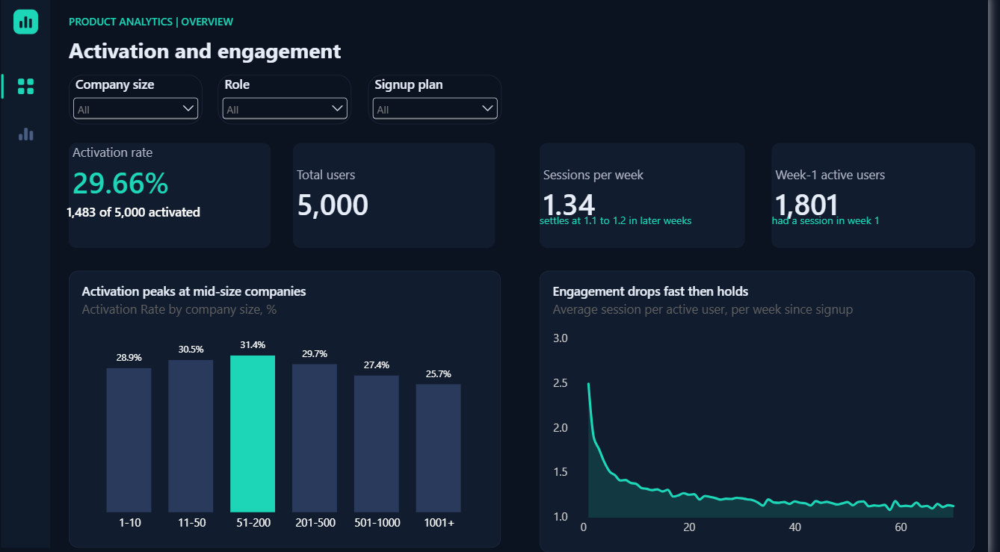
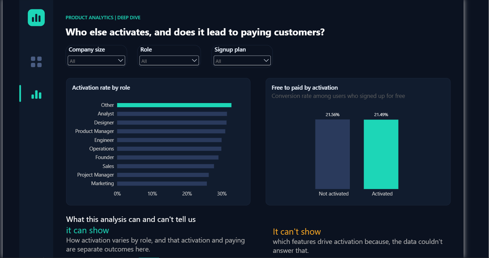

SaaS Product Activation and Engagement Analysis
Result: about 30% of new users activate in their first 7 days, activation is highest at mid-size companies, engagement settles into a steady weekly rhythm after an early drop, and activation does not predict upgrading to a paid plan.

Tools: SQL Server (SSMS), Power BI, DAX

Data: synthetic dataset of 5,000 users (no real customer data)

---
1. Business context
The product is used by organizations of all sizes, from very small teams up to large enterprises. It follows a well-known SaaS strategy called freemium, or product-led growth (PLG). Because it is a PLG business, conversion from free to paid is one of the most important things the business cares about. This is why activation and feature adoption become central business questions.

2. Business questions
What percentage of users become activated (within 7 days of signup), and does that rate differ by role or company size?
How engaged are users over time (sessions or events per week), and does engagement taper off or stay steady?
Which features are most and least used among activated users specifically? (This could not be answered with the data. See Limitations.)
Are activated users more likely to eventually convert to paid, compared to non-activated users?

3. Data
The dataset is synthetic. It was generated for practice and contains no real people or companies. It has 5,000 users, 69,940 recorded sessions, and one subscription history per user.

4. Method
Imported the four source tables and created a date table in Power BI.
Built the analysis in SQL Server: activation, segments, weekly engagement, and conversion, and verified each result.
Saved the two reusable results as SQL views so Power BI can use them as tables:
`vw_user_activation`: one row per user, with `is_activated` and `is_converted`
`vw_user_weekly_sessions`: one row per user per week, with `session_count`
Modelled the data in Power BI: the views link to `users` on `user_id`, and `DimDate` links to `signup_date`.
Designed a two-page dashboard with a dark theme and a single teal highlight colour.
Why views and not rebuilding the logic in DAX: the activation and conversion rules were already written and verified in SQL. Saving them as views reused that work and kept one source of truth. The percentages live in Power BI measures, not in the views, so every slicer click recalculates them.
Every number was checked against an independent SQL result before it went on the dashboard. The SQL for both views is in the `sql` folder.

5. Key definitions
Activated user: a user who performed at least one of seven core events within seven days of their signup date. The seven events are `project_created`, `task_created`, `teammate_invited`, `file_uploaded`, `integration_connected`, `time_tracking_used`, and `custom_field_created`.
Week number: weeks since signup, counted from 1. Days 0 to 6 are week 1, days 7 to 13 are week 2, and so on.
Converted user: a user who signed up on the Free plan and later had a non-Free plan in their subscription history.
`is_converted` is NULL for users who signed up on a paid plan. They never had a free-to-paid step, so the question doesn't apply to them. NULL ("not applicable") is different from 0 ("did not convert"). Power BI's average ignores NULLs, so these users are left out of the conversion rate without any extra filtering.

6. Key findings
Question	Finding
Activation	29.66% of users activated (1,483 of 5,000)
Segments	Highest for companies of 51-200 employees (31.42%), lowest for 1001+ (25.66%)
Engagement	Average sessions per active user fall from 2.49 in week 1 to 1.89 in week 2 and 1.37 in week 10, then settle at about 1.1 to 1.2 in later weeks. 1,801 users had a session in week 1.
Conversion	21.54% of Free signups converted (841 of 3,905). Activated users converted at 21.49% and non-activated users at 21.56%, so there is no gap by activation.
Being activated is not associated with a higher chance of paying. Mid-size companies activate most, though the data can't say why.

7. Limitations and assumptions
The data is synthetic. The patterns found here illustrate the method and shouldn't be read as facts about real products.
Correlation, not causation. The analysis shows how groups differ. It doesn't show what causes the differences.
Activation is a defined choice. Seven events within seven days is a reasonable but arbitrary definition, and different definitions could change the results.
Average sessions only cover active users. The measure tells you how intensely users behave in weeks when they showed up, not how many stayed. The weekly active users count shows that.
Late weeks are hidden. Weeks beyond 70 are not shown because too few users remain to trust the average.
Small segments. When filtered to one company size or role, samples are smaller, and gaps of a point or two may be noise.
Feature adoption was not answerable. The data couldn't support a reliable link between specific features and activation.

8. Lessons learned
A query that runs is not necessarily right. Row counts and averages must be checked against known results.
A filter can change who is in your data. Removing a Free-only filter to include everyone made conversion look like 38%. The NULL rule restored the right population without dropping any rows.
Blank is not zero. Using NULL for "not applicable" keeps averages honest.
Choose the function that matches the question. `COUNT`, `DISTINCTCOUNT`, `SUM` and `AVERAGE` each answer something different.
Build visuals from measures, not raw columns, so they respond to slicers and carry consistent formatting.
Say what the data can't answer. Naming limits made the analysis more credible, not less.
Next steps if extended: test other activation windows (3, 14 and 30 days), add feature-level data to learn which actions predict retention, and add a cohort retention view.
---
Author: Obioma Nmesoma Chidera
Contact: www.linkedin.com/in/nmesoma-chidera 
Email: obiomanmesoma2005@gmail.com
